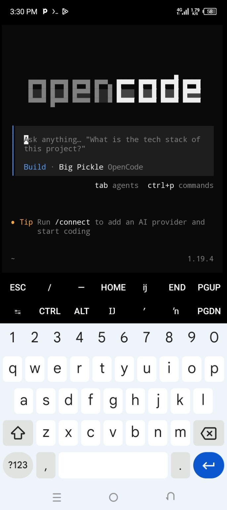

<div align="center">

# OpenCode AI — Ubuntu Setup

**A clean starter project to prepare Python tooling, install the OpenCode CLI, and launch it on Ubuntu/Debian Linux.**

[](https://ubuntu.com/)
[](https://www.python.org/)
[](https://www.gnu.org/software/bash/)

**Maintained by [@jr-scorpion](https://github.com/jr-scorpion)**

</div>

---

## 📸 Screenshots

### OpenCode welcome screen



---

## ✨ What this project does

This project provides two scripts:

- **`install.py`** — installs Node.js and npm through APT, installs the `opencode-ai` npm package globally, and launches the `opencode` command.
- **`install_python_modules.sh`** — installs Python 3, pip, and virtual-environment support; creates a local `.venv`; and installs packages from `requirements.txt` if any are listed.

The Python installer uses only Python's standard library, so **there are currently no third-party Python modules to install**. The Bash helper is included to make the Python environment reproducible and easy to extend later.

> **Unofficial community setup:** This repository is not affiliated with or maintained by the OpenCode project. Package names and recommended installation methods can change; check the official OpenCode documentation before installing.

## 🧰 Requirements

- Ubuntu or another Debian-based Linux distribution with `apt-get`
- Internet access
- A user account with `sudo` permission
- Bash
- Python 3 (the helper can install it)
- Node.js and npm (the Python installer installs these)

## 🚀 Quick start

### 1. Get the project

Clone your repository (replace the example URL if your repository has a different name):

```bash
git clone https://github.com/jr-scorpion/OpenCode-AI.git
cd OpenCode-AI
```

Or download the ZIP from this repository and extract it.

### 2. Make the Python environment ready

```bash
chmod +x install_python_modules.sh
./install_python_modules.sh
```

This installs Python tooling and creates a `.venv` folder. Since `requirements.txt` contains no external dependencies, pip does not install extra modules.

### 3. Install and launch OpenCode

```bash
./.venv/bin/python install.py
```

The script will request your password when `sudo` is needed. It updates APT, installs Node.js/npm, installs `opencode-ai`, and then attempts to start OpenCode.

You can also run it directly with system Python:

```bash
python3 install.py
```

## 🧪 Useful commands

Check your versions:

```bash
python3 --version
node --version
npm --version
```

Check that OpenCode is available:

```bash
opencode --version
```

Launch OpenCode later:

```bash
opencode
```

## 📁 Project structure

```text
OpenCode-AI/
├── README.md
├── install.py
├── install_python_modules.sh
├── requirements.txt
└── images/
    ├── opencode-home.jpg
    └── install-script.jpg
```

The `.venv/` directory is generated locally and should not be committed to GitHub.

## 🛠️ Troubleshooting

- **`apt-get` not found:** The scripts target Ubuntu/Debian-based systems. Use the installation method recommended for your distribution.
- **`sudo` fails:** Check that your user has administrative privileges.
- **`opencode: command not found`:** Confirm the npm install completed, reopen the terminal, and check npm's global executable directory is on `PATH`.
- **Node.js is too old:** Ubuntu/Debian repositories may provide a version that is not suitable for a current OpenCode release. Check the official OpenCode requirements and use a supported Node.js installation method.
- **Python package errors:** Add any required third-party package to `requirements.txt`, one package per line, then rerun `./install_python_modules.sh`.

## 🔐 Safety notes

- Read scripts before running them, especially scripts that use `sudo`.
- This project runs package-manager commands and installs a global npm package.
- Do not run these commands on a production machine unless you understand the changes they make.
- The scripts do not configure an AI provider or store API keys. Follow OpenCode's documentation to configure a provider securely.

## 👤 Author

**GitHub:** [@jr-scorpion](https://github.com/jr-scorpion)

If you find this useful, ⭐ star the repository and open an Issue with suggestions or bugs.

---

<div align="center">

Made with 🖤 by [jr-scorpion](https://github.com/jr-scorpion)
